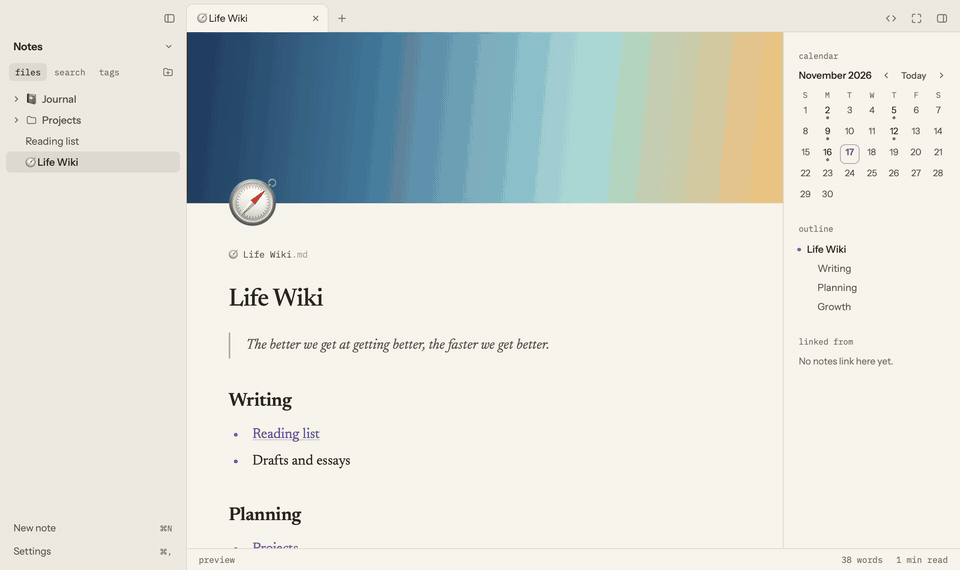
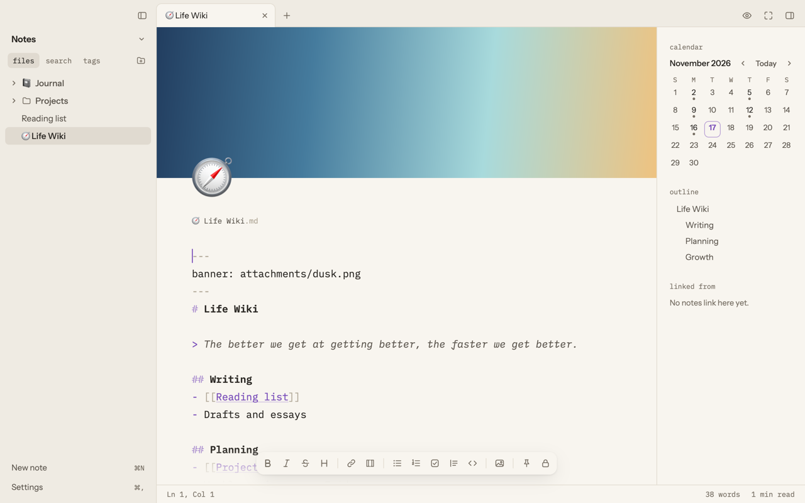
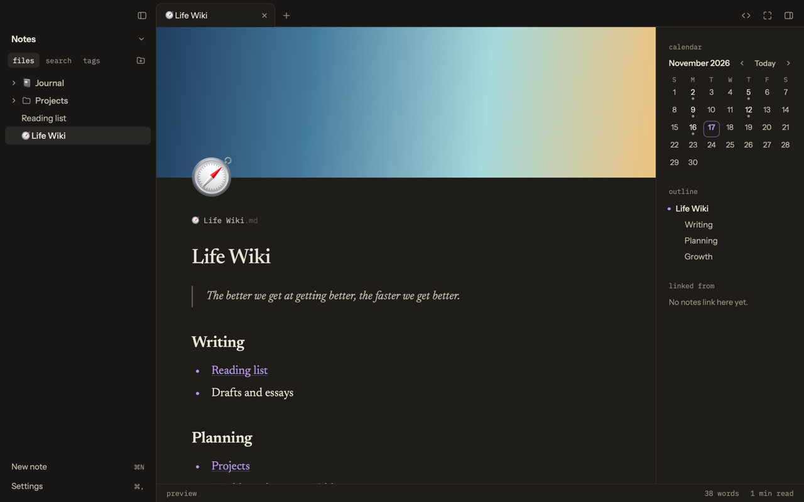
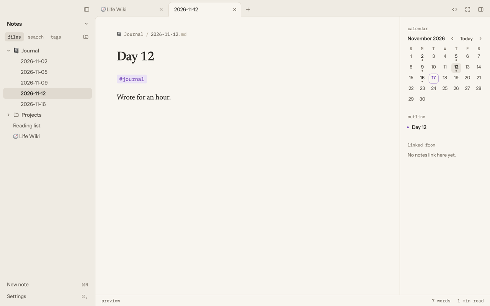
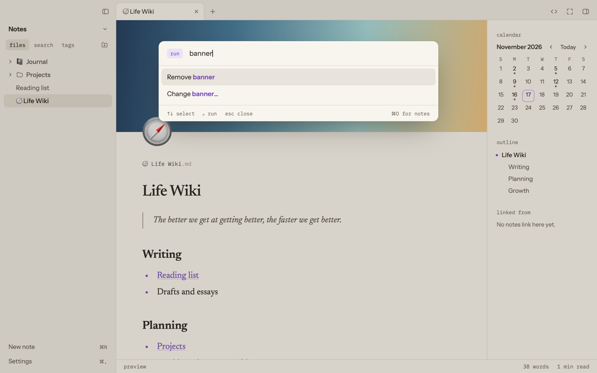
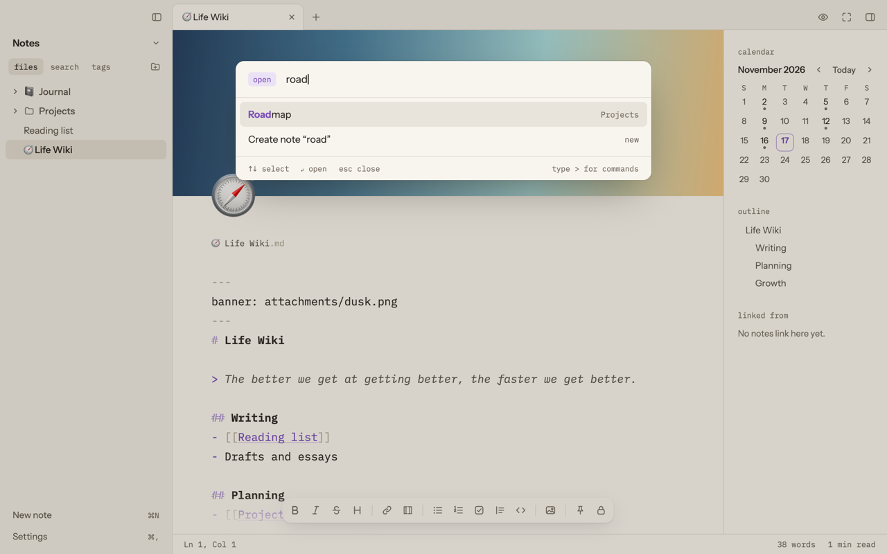
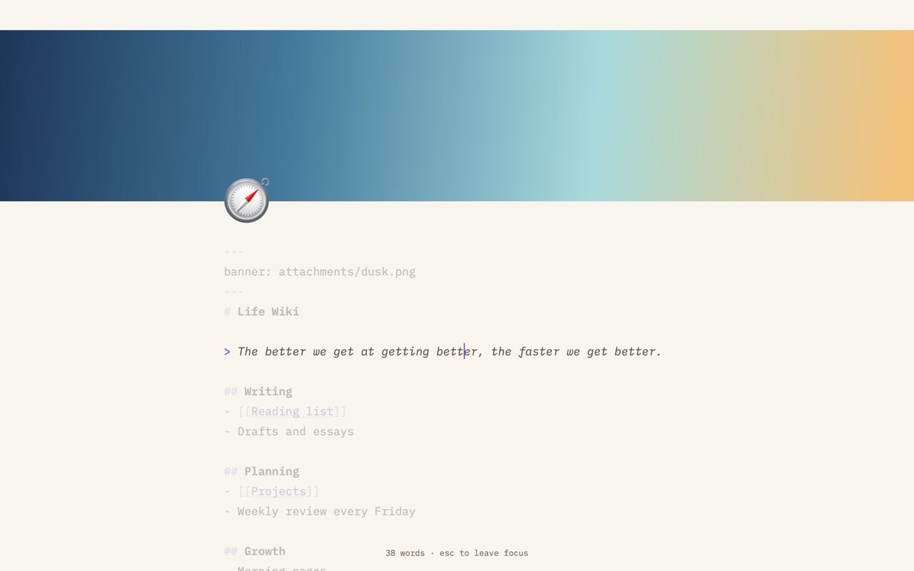

<p align="center">
  <picture>
    <source media="(prefers-color-scheme: dark)" srcset="assets/brand/mark-on-ink.svg">
    
  </picture>
</p>

<h1 align="center">zotebook</h1>

<p align="center">A plain editor for folders of Markdown files.<br>
Each note is a <code>.md</code> file on your disk, so any other app can open it.</p>

<p align="center">
  <a href="https://zotebook.klectr.dev/">Website</a> ·
  <a href="#install">Install</a> ·
  <a href="#sync-your-devices">Sync</a> ·
  <a href="#use-it-with-your-ai-tools">MCP server</a> ·
  <a href="site/assets/zotebook.mp4">Video</a>
</p>

<p align="center">
  <a href="site/assets/zotebook.mp4"></a>
</p>

## What you get

Zotebook opens a folder and edits the Markdown files in it. There is no database, no import step and no lock-in.

- **Write in Markdown.** Source mode highlights the syntax as you type, in a monospaced font. `Ctrl+E` switches to a preview that reads like a printed page.
- **Format with a click.** A floating toolbar at the bottom of the note stays in view while you scroll. It makes text bold, italic or struck through, adds headings, links, lists, tasks, quotes and code, and inserts images. `Ctrl+B`, `Ctrl+I` and `Ctrl+K` work too. Settings, Editor can hide it.
- **Lock a note.** The lock button in the toolbar encrypts a note with its own password. A locked note shows nothing until you enter the password, and it syncs encrypted.
- **Paste from anywhere.** Formatted text from a web page or a document pastes as Markdown, with its headings, lists, links and emphasis. A web address pasted over selected text makes a link.
- **Add images.** Drag an image onto a note, paste one, or use the image button in the toolbar. Zotebook copies it into `attachments/` and links it. The preview shows `` and `![[name.png]]` images, and web images too.
- **Give a page a face.** Hover over a note's name to add an icon or a banner. The icon is an emoji at the start of the file name, so it shows in the tree too. The banner is an image in `attachments/`, kept in the note's front matter as `banner:`. "Add banner…" and "Remove banner" are in the command palette as well.
- **Keep a journal.** The calendar above the outline marks today and puts a dot under each day that has a note. Click a day to open its note, `Journal/2026-11-17.md`, or to start it. **Today** jumps back to today.
- **Link notes.** Write `[[Note name]]` and `Ctrl`-click to follow it. A link to a missing note creates the note. Renaming a note rewrites the links to it.
- **Find anything.** `Ctrl+O` opens any note by a fuzzy name. `Ctrl+P` runs any command. `Ctrl+Shift+F` searches every note. Tags (`#idea`) get their own list.
- **Keep folders tidy.** Make folders in the file tree, drag notes into them, and use the `+` on a folder to make a note there. Click a folder's icon to give it any emoji as its icon: the emoji is the first character of the folder name on disk, so it stays with the folder, and the tree shows the rest of the name beside it. To delete a folder, right-click it. The folder moves to `.trash` with its files. To keep a note at the top of the tree, right-click it and select **Pin**. Pins sync with the notes. In the quick switcher, `Drafts/Idea` makes the note in `Drafts`. A note inside a folder with the folder's own name, such as `Projects/Projects.md`, is the folder's note: it stays out of the tree, and clicking the folder's name or following `[[Projects]]` opens it, making it if it is missing. The chevron opens the folder itself. Preview mode stays on as you move between notes.
- **Sync your devices.** Keep a notes folder the same on all your computers, through object storage that you control, with optional encryption.
- **Focus.** `Ctrl+.` or the focus button hides everything but the text, dims the other paragraphs and keeps the line you type near the middle.
- **Look at home.** Pick a theme for light mode and one for dark mode from 14 themes, such as White, Black, Nord, Gruvbox, Catppuccin, Tokyo Night, Rosé Pine and Solarized. Pick an accent colour, or type any hex value. "Match system" switches between your two themes. On Omarchy, your Omarchy theme is one of the choices. Choose one of four monospaced editor fonts, including Maple Mono.
- **Stay up to date.** When a new release is out, an **Update** button shows at the top right. Select it, and Zotebook installs the new version and restarts. This works on Linux, macOS and Windows.
- **Work with AI tools.** A built-in MCP server lets Claude Desktop, Cursor and other MCP clients read and search your notes.

<table>
  <tr>
    <td></td>
    <td></td>
  </tr>
  <tr>
    <td align="center">Banners and icons</td>
    <td align="center">Preview, dark</td>
  </tr>
  <tr>
    <td></td>
    <td></td>
  </tr>
  <tr>
    <td align="center">Journal calendar</td>
    <td align="center">Command palette</td>
  </tr>
  <tr>
    <td></td>
    <td></td>
  </tr>
  <tr>
    <td align="center">Quick switcher</td>
    <td align="center">Focus mode</td>
  </tr>
</table>

## Install

Download the build for your system from the [latest release](https://github.com/Klectr/zotebook/releases/latest):

| System | File |
| --- | --- |
| Linux, x86-64 | `zotebook-<version>-linux-x86_64.tar.gz`. Unpack it and run `./install.sh`. |
| macOS, Apple silicon | `zotebook-<version>-macos-arm64.zip`. The app is not notarized, so right-click it and choose **Open** the first time. |
| Windows, x86-64 | `zotebook-<version>-windows-x86_64.zip`. The app is not signed, so SmartScreen can warn you. |

Zotebook is pre-release. To build it yourself, follow the steps below.

### Desktop (Linux)

You need Rust and, on Linux, the `libxkbcommon` and `wayland` development packages. `rustup` installs the pinned toolchain on the first build.

```sh
git clone https://github.com/Klectr/zotebook
cd zotebook/desktop
./install.sh        # builds, then installs zotebook, its icon and a launcher entry for your user
zotebook ~/notes    # or open Zotebook from the app launcher
```

The desktop app is built with [Rune](https://github.com/anomalyco/rune), a GPU-rendered Rust UI framework. Rune also targets macOS and Windows, but Zotebook is tested on Linux only. See [`desktop/README.md`](desktop/README.md).

### Coming from Quire

Zotebook was called Quire. The first time Zotebook starts, it moves Quire's settings into its own folder: your notes folders, open tabs, themes and sync keys carry over. Notes folders that synced to the old default remote folder, `quire/<folder name>/`, keep it. Notes locked in Quire open in Zotebook.

- On macOS, delete `Quire.app` after you install `Zotebook.app`.
- Quire's **Update** button can't install Zotebook. Download it once from the [latest release](https://github.com/Klectr/zotebook/releases/latest).
- If an AI app starts Quire's MCP server, paste the new configuration from Settings, MCP.

## Use it with your AI tools

Turn on the server in Settings, MCP. Then paste the client configuration from that page into your AI app. With the stdio transport, the AI app starts Zotebook's helper itself:

```json
{
  "mcpServers": {
    "zotebook": { "command": "zotebook", "args": ["mcp", "--folder", "/path/to/notes"] }
  }
}
```

Access is read-only by default. Each tool has its own switch, and hidden folders stay out of listings and search. The HTTP transport serves `http://127.0.0.1:3917/mcp` while the app is open and needs the access token from Settings.

## Sync your devices

Zotebook keeps a copy of your notes in object storage that you control. Every computer uses the same format, so a note you write on one opens on the others.

1. Make a bucket at your provider and an access key for it.
2. Open Settings, Sync & backup, and select the provider.
3. Fill in the bucket and the key.
4. Select **Test connection**. Sync starts when the test passes.

Zotebook works with Amazon S3, Hetzner, Azure Blob Storage, Google Cloud Storage, Cloudflare R2, Backblaze B2, DigitalOcean Spaces, Wasabi, Scaleway, OVHcloud and any other S3-compatible server, such as MinIO.

A notes folder that is the root of a Git repository can also sync with GitHub. Zotebook commits the folder, rebases the current branch onto its remote and pushes it, using the Git credentials already configured on the computer. Git reports a conflict and Zotebook stops so you can resolve it. Pins stay local, and the encryption option does not apply.

- **Encrypt before upload** encrypts each note with AES-256-GCM before upload. The key comes from your passphrase, so the provider stores neither note names nor note text. If you lose the passphrase, nobody can open the remote copy. This option is for object storage; GitHub uses Git.
- **When to sync** is **On save**, **Every 5 min** or **Manually**. **Sync now** is also in the command palette.
- With object storage, when two devices change the same note, Zotebook keeps both versions. The other device's text goes to `<name> (conflict <device>).md` next to the note. With GitHub, Git reports the conflict and Zotebook stops so you can resolve it.
- Images in the notes folder sync too, up to 50 MB each.
- Folders sync too, empty ones included. A note or a folder that you delete on one device moves to `.trash` on the other devices.

For object storage, each notes folder syncs to its own remote folder, `zotebook/<folder name>/` unless you set another one in **Remote folder**. To sync one notes folder between two devices, give it the same remote folder on both.

[`SYNC.md`](SYNC.md) describes the remote format, so other tools can read and write it.

## Not in this version

- With "Ask before changes" on, MCP tools that write return an error, because there is no approval prompt yet.
- GitHub sync needs Git installed and a notes folder that is the root of a Git repository with a remote.
- The macOS and Windows builds come from CI and are not tested on those systems yet.

## In this repository

| Folder | What it holds |
| --- | --- |
| [`desktop/`](desktop) | The desktop app, in Rust with Rune. |
| [`site/`](site) | The website, static files served by GitHub Pages. |
| [`design/`](design) | The design prototype that the app follows. |
| [`assets/`](assets) | The brand marks and the fonts, which keep their SIL Open Font License. |

Zotebook is MIT licensed.
